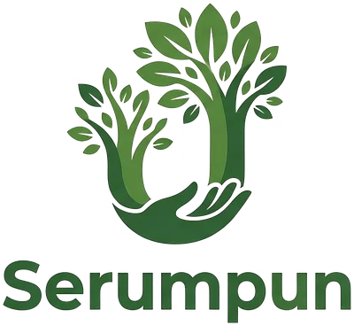

  

<h1 align="center">Serumpun</h1>

<i>Tumbuh bersama, berjiran bersama.</i>

Serumpun is a greenhouse community app for residents of Sime Darby Property townships. It connects home gardeners in each housing area, and connects housing areas with each other, so neighbours trade plants, learn from experienced gardeners and organise events together.

Built for the **Sime Darby Property University Hackathon 2026**, theme **People: Neighbourhood Connection**.

**Live demo:** `https://faridnurahim-dot.github.io/SERUMPUN-/` *(replace after enabling GitHub Pages)*

---

## The problem

Most residents who garden do it alone at home. Greenhouse groups exist in many housing areas, but each one is an island: beginners have no one to ask, experienced gardeners have no one to teach, and groups depend on a few volunteers who drift away.

## Features

### Resident app
| Feature | What it does |
|---|---|
| **Main feed (learn)** | Reddit-style feed of questions, tips and tutorials from your community and the communities you follow. Like, comment and answer. Mentor answers are marked. |
| **Communities** | Search communities by area, grouped by township. Join your own and follow others. |
| **Trade** | Offer plants, seeds and fertiliser. Send a trade request, get it accepted, meet at the greenhouse gate, mark it done. |
| **Make trading** | Post what you want and what you give, with optional photos. |
| **Events** | Join events, see capacity, and volunteer for committee roles. Organise your own event. |
| **Notifications** | Event reminders, trade updates, answers to your questions, SDP announcements. |
| **Profile** | Photo, editable name and email, posts, contributions and account age. |

### Township Dashboard (SDP admin)
- Headline numbers: active members, posts and answers, trades completed, mentor pairs, events, new neighbour links
- Weekly activity chart and health per community (thriving, slowing, needs support)
- Beginner retention with and without a mentor, resident survey, popular learning topics
- Filters by township and period
- Actions that reach residents: post an announcement, sponsor an event, offer greenhouse space, export a report

Actions taken in the resident app are counted live on the dashboard.

## Screenshots

| Login | Main feed | Question | Trade | Event | Profile |
|---|---|---|---|---|---|
|  |  |  |  |  |  |

## Run it

**Online:** open the live demo link. On a phone, use *Add to Home Screen* (Android: Chrome menu; iPhone: Safari Share button) to install it as an app.

**On your computer:** download this repository and double-click `index.html`. No installation or build step is needed.

**Demo login:** the details are already filled in. Press *Log in*.

## How it's built

- One self-contained page: HTML, CSS and vanilla JavaScript, no frameworks or build tools
- Progressive Web App: `manifest.webmanifest` makes it installable, and `sw.js` caches it so it works offline after the first visit
- Data is sample data saved in the browser's local storage. *Profile → Reset demo data* restores the starting state.

| File | Purpose |
|---|---|
| `index.html` | The whole app: screens, styles, logic and dashboard |
| `manifest.webmanifest` | App name, icons and full-screen settings |
| `sw.js` | Offline cache |
| `*.webp`, `icon-*.png` | Logo and app icons |
| `screenshots/` | Images for this README |

## Roadmap

- AI Plant Doctor: photo of a sick plant → likely pest or disease and simple treatment
- Smart trade matching that favours neighbours you haven't met yet
- Real accounts and a shared database for a pilot township

## Team

| Name | Role |
|---|---|
| [MUHAMMAD ARFAN BIN SHAMSUL] | [SOFTWARE TESTER] |
| [MUHAMMAD FARID AZIZI BIN NURAHIM] | [SOFTWARE DEV] |
| [MUHAMMAD ARIF FAHIM BIN MUHAMMAD SHARUL AZLEE] | [SYSTEM ANALYST] |
| [MUHAMAD ALIM BIN MOHAMAD KHAIRANI] | [SOFTWARE DESIGNER] |
| [MUHAMMAD ARIF BIN MOHD SAYUTI] | [UI/UX DESIGNER] |

Universiti Kebangsaan Malaysia · APHELIOS · Sime Darby Property University Hackathon 2026

> All names and figures in the prototype are sample data.
